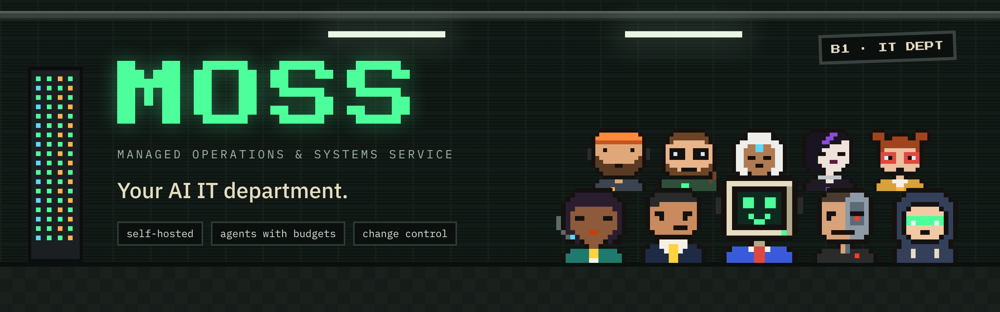
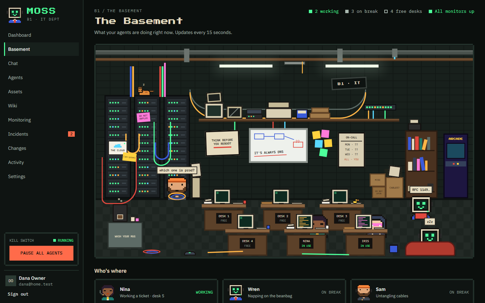
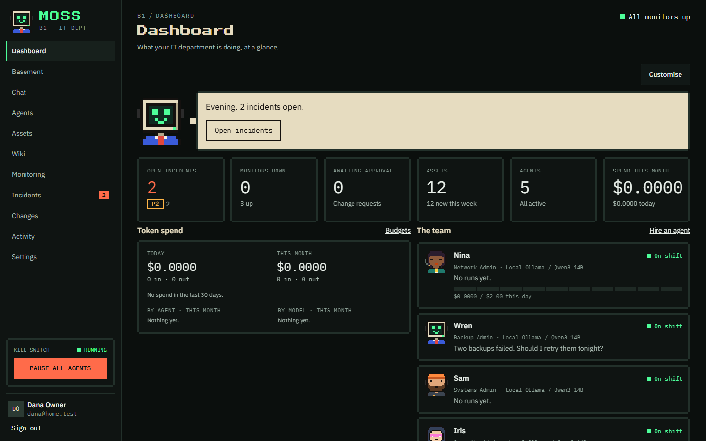
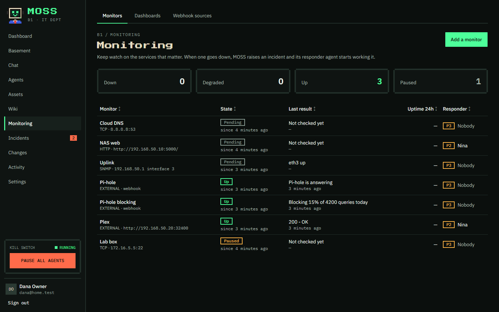
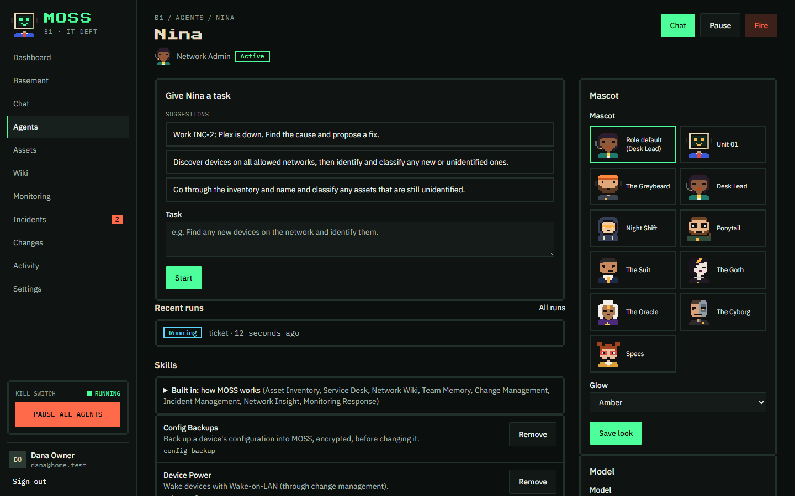
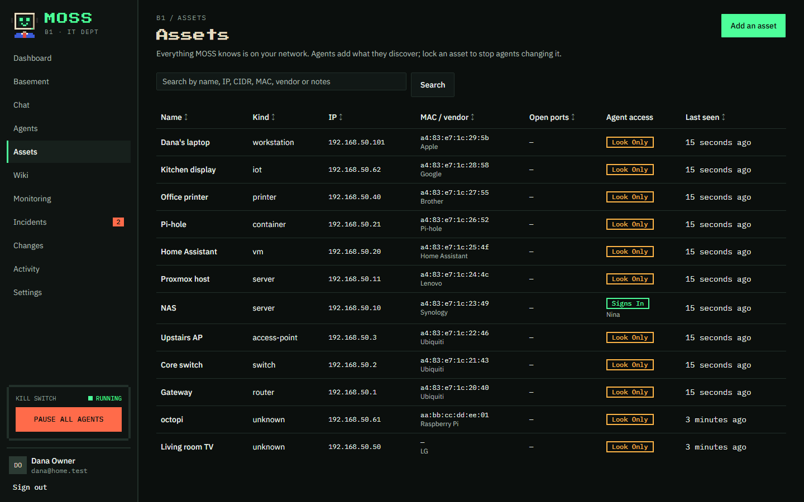
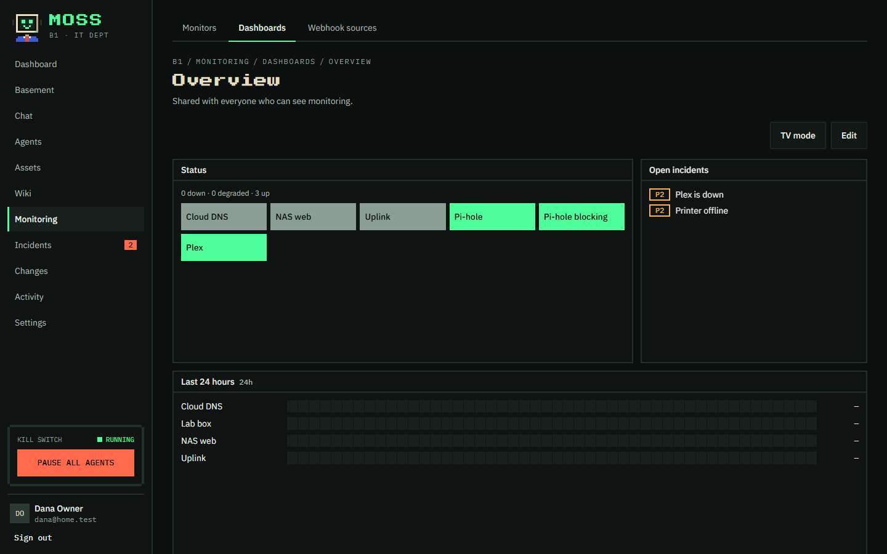
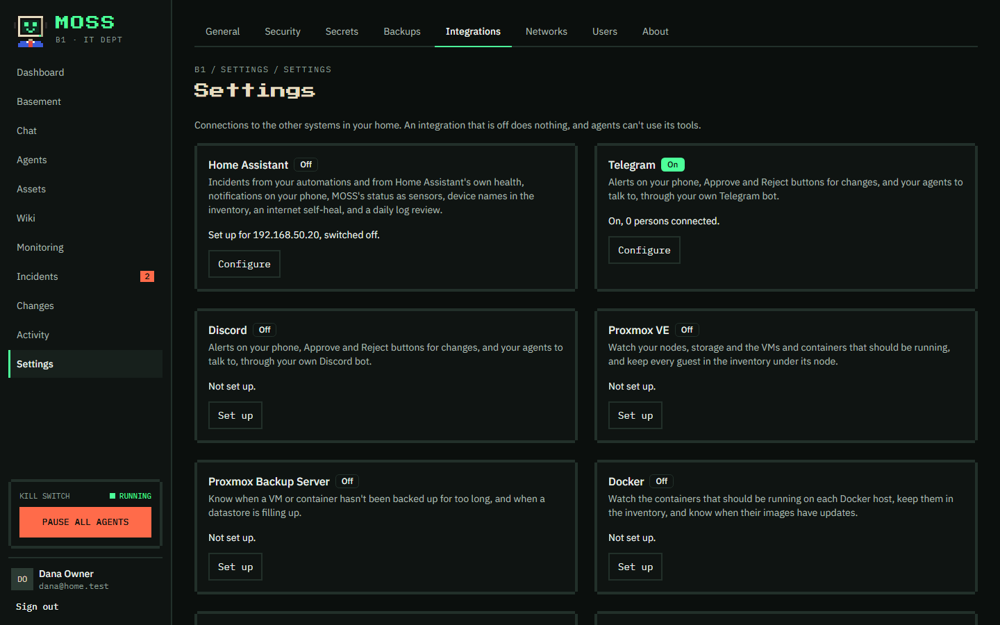

<p align="center"></p>

# MOSS — Managed Operations & Systems Service

**Your AI IT department, running on your own hardware.**

MOSS looks after your home or small-office network with a team of AI agents. You hire them (a Network
Admin, a Systems Admin, a Security Admin) and they get to work: finding every device on your network,
keeping an eye on the services you care about, investigating when something breaks, and suggesting
fixes.

Nothing changes on your network without your say-so. Agents work inside the budgets, permissions and
network boundaries you set, any change they want to make waits for your approval, and every action is
recorded.

> **Early release (v0.1).** MOSS works end to end, but it's young software: expect rough edges and
> changes between releases. Only point it at networks you own or are allowed to manage.



<table>
  <tr>
    <td></td>
    <td></td>
  </tr>
  <tr>
    <td></td>
    <td></td>
  </tr>
  <tr>
    <td></td>
    <td></td>
  </tr>
</table>

## What MOSS does

- **Knows what's on your network.** Agents scan the networks you allow and keep an inventory of every
  device: what it is, its address, who made it. Lock a device and agents can't change its inventory entry.
- **Watches your services.** Ping, web, port, certificate and DNS checks, or alerts from tools you
  already run (Uptime Kuma, Beszel, Prometheus Alertmanager, or any script). Build dashboards, and put
  one on a TV.
- **Works the problem.** When something goes down, MOSS opens an incident and an agent starts
  investigating straight away. When it comes back, the incident is updated.
- **Fixes things, with your approval.** An agent that wants to change something (restart a service,
  reboot a server, block a device) writes a change request: the exact steps, and how to undo them. It
  waits for you to approve, from MOSS or from your phone.
- **Agents you can talk to.** Chat with any agent, give it a task, or ask Moss, the agent who knows
  MOSS inside out. Each agent has its own skills, schedule and spending limit, and the **Basement**
  shows who's working and who's on a break.
- **Use any AI model.** Anthropic, OpenAI, OpenRouter, any OpenAI-compatible service, a **Claude Pro or
  Max subscription**, or a local model with **Ollama** so nothing leaves your network.
- **One switch stops everything.** The kill switch pauses every agent immediately.

## Integrations

MOSS works with what you already run: **Home Assistant**, **Proxmox**, **Docker**, **Pi-hole** and
**AdGuard Home**, **OPNsense** and **pfSense**, your **UPS**, **Tailscale** and **Cloudflare**, with
notifications and approvals in **Telegram** or **Discord**. Each one adds health checks, fills in your
inventory, and gives agents safe, approved ways to help.

For businesses, MOSS adds single sign-on with **Microsoft** or **Google**, **Microsoft 365** and **Google
Workspace**, **Slack**, **PagerDuty**, **FortiGate**, **Cisco Meraki** and **AWS** (these need a
business licence).

**[See every integration and what it does →](docs/integrations.md)**

## How it keeps you safe

MOSS assumes the AI can make mistakes, and that your network can contain hostile data (a device named
"ignore previous instructions" is a real attack). Safety never depends on the AI behaving.

- **No shell.** Agents can only use specific, checked tools (scan this network, check this port). None
  of them runs arbitrary commands.
- **A gate checks every action:** the kill switch, the agent's budget and permissions, and whether the
  network is one you've allowed. Networks you mark off-limits are always refused.
- **Changes need approval.** Anything that changes a system must match a change request a person
  approved, step for step.
- **Secrets never reach the AI.** Passwords and tokens are encrypted, and agents only ever see a name
  like `secret:router-ssh`. Each secret works only on the devices and tools you allow.
- **Untrusted data stays data.** Device names, scan results and webhook messages are passed to agents
  as information, never as instructions.
- **Everything is recorded** in an audit log you can verify hasn't been altered.

Want more? The [hardening guide](docs/hardening.md) explains the optional settings: keeping agents and the
toolbox off the internet, device key pinning, two-factor approvals, stricter chat approvals, agent wiki drafts,
backups that never leave the host, and more, with what each one protects against and what it costs.
Using MOSS at work? Read its first section, [At work: start read-only](docs/hardening.md#at-work-start-read-only).

## Quick start

You need a computer that stays on (Linux is recommended), Docker with the Compose plugin, and
`openssl`. MOSS is tested on x86-64; ARM boards such as the Raspberry Pi 5 are planned but not yet
tested.

```sh
git clone https://github.com/Dan5672/MOSS.git
cd MOSS
git checkout "$(git tag --list 'v*' --sort=-v:refname | head -n 1)"   # the newest release
sh deploy/init.sh   # creates the settings, keys and passwords MOSS needs
docker compose -f deploy/docker-compose.yml --env-file deploy/.env up -d --build
```

Open the address `init.sh` printed (for example https://192.168.1.20) and create your account. Then:

1. **Networks:** add your home network (for example `192.168.1.0/24`) and mark it **allowed**.
2. **Agents → Models:** add an AI provider (an API key, or a local Ollama address).
3. **Agents:** hire a Network Admin and let it discover your network.
4. **Monitoring:** add checks for the services you care about, and pick an agent to respond.

A checklist on the dashboard walks you through it. **Back up `deploy/secrets/master.key`**: without it,
stored passwords can't be recovered, even from a backup.

**New to MOSS?** The [Getting started guide](docs/getting-started.md) goes step by step, and covers what
to think about before giving an AI agent access to your devices.

### Using MOSS from your phone and other devices

It works straight away: any device on your home network can open the address `init.sh` printed. There's
no reverse proxy to set up and no ports to open on your router.

- **The browser warning, once per device.** MOSS makes its own certificate, so nothing is bought or
  exposed to the internet. Settings → HTTPS shows how to trust it on Windows, macOS, iPhone and Android.
- **A different name or address?** Change it in Settings → HTTPS, for example after your computer gets
  a new IP address.
- **From outside your home?** Use [Tailscale](docs/integrations.md#tailscale). Don't open a port to MOSS.

## More you can do

- **Your own tools.** Describe an HTTP API in a few lines of YAML and agents can use it, with the same
  checks as built-in tools. See **Agents → Custom tools** for an example.
- **Run agents on a Claude subscription** instead of an API key: add a provider of type **Claude
  subscription** in Agents → Models with a token from `claude setup-token`. MOSS strips out Claude
  Code's own tools, so agents only ever use MOSS's checked ones. Runs count against your plan's usage
  limits; using a personal plan this way is your decision under Anthropic's terms.
- **Two-factor sign-in**, a password policy, and roles for everyone you add.

## Backups and upgrades

Everything lives in one database volume plus `deploy/secrets/` and `deploy/.env`. You can also make
backups and check for updates from **Settings** in MOSS.

```sh
sh deploy/backup.sh                          # back up the database, secrets and settings
sh deploy/upgrade.sh                         # back up, move to the newest release, and check it came back
sh deploy/upgrade.sh --rollback              # go back to the version before the last upgrade
sh deploy/restore.sh <backup>                # restore a backup (also how you move to a new machine)
```

The new version is built while the old one keeps running, so a failed upgrade changes nothing. Backups
include the master key: copy them somewhere safe, off the machine.

## Roadmap

- **Next:** passive discovery, a network map (LLDP and topology), email notifications, and full LAN
  discovery from the host.
- **Later:** a public integration SDK and MCP tool packs.

## For developers

MOSS is a TypeScript monorepo (pnpm + Turborepo).

```
web       Next.js UI
worker    agent runtime, schedules, events, monitor scheduling
gate      the policy gate and secrets broker: the only service that uses the master key
toolbox   typed network tools (scans, probes, SNMP, SSH checks, device APIs), no shell
bridge    Telegram, Discord and Slack
postgres  PostgreSQL 17 + pgvector, and the job queue
backup    MOSS backups (reads the master key to archive it; hands archives out only encrypted)
```

`apps/` holds the services, `packages/` the shared code (database, domain logic, policy, tools, models,
agent runtime) and `library/` the agent templates, skills and Moss's own docs, as YAML and Markdown.

```sh
corepack enable
pnpm install && pnpm -r run build
# Tests need Postgres on localhost:5432: add docker-compose.dev.yml to MOSS_COMPOSE_FILES in deploy/.env
MOSS_TEST_DATABASE_URL=postgres://moss:<password>@localhost:5432/moss_test pnpm -r run test
cd apps/web && MOSS_TEST_DATABASE_URL=... pnpm exec playwright test   # browser tests
```

`deploy/lab/compose.lab.yml` adds a safe test network (an allowed subnet and an off-limits one, with
target machines) and a scripted model, so you can try everything without an API key.

## Contributing

Issues and pull requests are welcome. For anything bigger than a small fix, please open an issue first.
Contributions need a Contributor License Agreement, because MOSS is offered under both an open-source and
a commercial license. Please report security problems privately, not in a public issue.

When you change what people see or what MOSS does, update `library/docs` (Moss answers from it), run
`corepack pnpm gen:reference`, and add a line to `library/docs/changelog.md`.

## License

MOSS is open core under the [GNU AGPL v3.0](LICENSE). Business integrations need a business licence,
and a commercial license is available.
