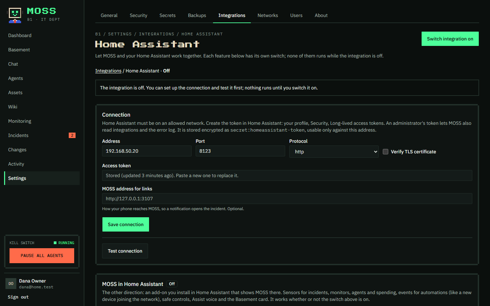

# Integrations

MOSS connects to the systems you already run. Each one is set up in **Settings → Integrations**, and
each page has the same shape: how to connect, a **Test connection** button, a switch for each feature,
and what it last found.

A few rules apply to all of them:

- **Off means off.** While an integration is switched off, none of its features run and agents can't
  use its tools.
- **Credentials stay locked away.** Tokens and passwords are stored encrypted and can only be used
  against the address you gave and with that integration's tools. Agents never see them.
- **Reading is automatic, changing is not.** Health checks and inventory syncs run on their own.
  Anything that changes a system goes through a change request that a person approves.
- **Health checks become monitors.** When something an integration watches goes wrong, MOSS opens an
  incident for the responder you choose, and the readings (latency, disk use, battery charge) can be
  graphed on dashboards.
- **Devices land in the inventory.** Integrations that know about devices add them to Assets,
  matched to devices MOSS already knows. Names you gave and assets you locked are never changed.

**Contents:** [Smart home and home lab](#smart-home-and-home-lab) ·
[Networks and firewalls](#networks-and-firewalls) · [Notifications and chat](#notifications-and-chat) ·
[Remote access and the internet edge](#remote-access-and-the-internet-edge) ·
[Business integrations](#business-integrations) · [Agent-only tools](#agent-only-tools)

| Integration | What MOSS does with it | Can agents change things? | Plan |
| --- | --- | --- | --- |
| [Home Assistant](#home-assistant) | Alerts from automations, health, phone notifications, sensors, inventory, internet self-heal, log review | A smart plug, through a pre-approved change | Free |
| [Proxmox VE](#proxmox-ve) | Nodes, storage and VMs watched; guests in the inventory | Snapshots and power, through a change | Free |
| [Proxmox Backup Server](#proxmox-backup-server) | Guests without a recent backup, datastores filling up | No | Free |
| [Docker](#docker) | Containers that should be running; image updates | Restart a container, through a change | Free |
| [Pi-hole](#pi-hole) and [AdGuard Home](#adguard-home) | Blocking switched off, device names | Block or allow a domain, local DNS, through a change | Free |
| [UPS (Network UPS Tools)](#ups-network-ups-tools) | Power cuts, battery health, an orderly shutdown plan | Shut down guests and servers, through a change | Free |
| [OPNsense](#opnsense) and [pfSense](#pfsense) | Gateways, packet loss, updates, DHCP names | Block a device, through a change | Free |
| [Telegram](#telegram-and-discord) and [Discord](#telegram-and-discord) | Notifications, Approve and Reject buttons, chat with agents | No | Free |
| [Tailscale](#tailscale) | Servers on the tailnet, keys about to expire, devices | No | Free |
| [Cloudflare](#cloudflare) | What's exposed to the internet, tunnels | A DNS record, through a change | Free |
| [Sign in with Microsoft or Google](#single-sign-on) | Single sign-on for the people in MOSS | No | Business |
| [Microsoft 365](#microsoft-365) and [Google Workspace](#google-workspace) | Managed laptops and phones, service health, security alerts | No (read-only) | Business |
| [Slack](#slack) | Notifications, Approve and Reject buttons, chat with agents | No | Business |
| [PagerDuty](#pagerduty) | Page the on-call person for serious incidents | No | Business |
| [FortiGate](#fortigate) and [Cisco Meraki](#cisco-meraki) | Links, uplinks, VPNs, devices offline, firmware | No (read-only) | Business |
| [AWS](#aws) | Instances, alarms, what the internet can reach in your account | No (read-only) | Business |

---

## Smart home and home lab

### Home Assistant

**Connect:** Home Assistant's address and a long-lived access token (your profile → Security →
Long-lived access tokens). An administrator's token also lets MOSS read integrations and the error log.

| Feature | What it does |
| --- | --- |
| Alerts | Your automations send events to MOSS with a `rest_command` (the page gives you one to paste). Each becomes a monitor, and a problem opens an incident. |
| Health checks | Every 5 minutes: is Home Assistant answering, have integrations failed, are updates pending, are many entities unavailable. |
| Phone notifications | New incidents at or above a priority you choose go to the companion app, with a link to the incident. |
| Status sensors | `sensor.moss_open_incidents`, `sensor.moss_monitors_down`, `sensor.moss_changes_pending` and `binary_sensor.moss_agents_paused`. |
| Inventory sync | Home Assistant's device names, rooms, makers and models fill in your assets. |
| Internet self-heal | When your internet monitor has been down for a few minutes, an agent power-cycles the modem's smart plug through a pre-approved change, then checks the connection came back. At most once per incident. |
| Log review | Every day an agent reads Home Assistant's error log and raises incidents for anything new or getting worse. |

#### MOSS in Home Assistant

The other direction: a Home Assistant integration (in `custom_components/moss`) that shows MOSS in your
dashboards and automations.

1. Install it. With HACS, add this repository as a custom repository (category Integration) and install
   MOSS. Without HACS, download it from MOSS (Settings → Integrations → Home Assistant) and unzip it into
   Home Assistant's `config/custom_components`. Restart Home Assistant.
2. In MOSS, make a token on the same page. It acts as you, so Home Assistant can never do more than you can.
3. In Home Assistant: Settings → Devices & services → Add integration → MOSS, with MOSS's address and the token.

You get sensors for open incidents, monitors down, changes waiting and spend; a sensor per agent and per
monitor; events (incident opened, monitor down, **new device on the network** and more); a pause-all
switch and maintenance mode; the actions `moss.raise_incident`, `moss.ask_agent` and
`moss.acknowledge_incident`; a calendar of change windows; an update entity for new MOSS releases; and an
Assist agent so you can ask MOSS by voice. The **Basement card** (`custom:moss-basement-card`) shows your
agents at their desks on a dashboard.

Home Assistant can't approve changes or reach secrets, tools, networks or settings, and it can't resume
paused agents unless you allow it.

### Proxmox VE

**Connect:** any node's address (port 8006) and an API token (Datacenter → Permissions → API Tokens).
The PVEAuditor role is enough to read.

- **Health checks** every 5 minutes: each node (CPU, memory, disk as readings), each storage pool
  (warning at 90%, down at 98%), and each VM or container set to start at boot (down when it isn't
  running; others are left alone).
- **Inventory** every 6 hours: nodes, VMs and containers, each guest under its node.
- **Agents** can take a snapshot before changing a guest, and shut down, start or reboot it, through a
  change. The token then needs VM.Snapshot and VM.PowerMgmt.

### Proxmox Backup Server

**Connect:** its address (port 8007) and an API token with DatastoreAudit.

- Every 30 minutes: a monitor per backed-up guest, down when its last backup is older than the limit
  (2 days by default), and one per datastore (warning at 85% full, down at 95%).

### Docker

MOSS reads Docker through a **read-only socket proxy** on each host, never the Docker socket itself (full
Docker access is root). For example, run `tecnativa/docker-socket-proxy` with `CONTAINERS=1`, `IMAGES=1`,
`INFO=1` and `POST=0`, published on port 2375 to your LAN only.

**Connect:** the hosts, one per line. No credential.

- **Health checks** every 5 minutes: each container with a restart policy, down when it's stopped,
  restarting in a loop or unhealthy. Containers without one may be stopped on purpose and are left alone.
- **Inventory** every 6 hours: each host and its containers, with image and Compose project.
- **Image updates** (daily, optional): asks each registry whether a newer image exists for the tag,
  sending only image names.
- **Agents** can restart a container over SSH, through a change.

### Pi-hole

**Connect:** its address and an app password (Settings → Web interface / API → Configure app password).
Pi-hole v6 or newer.

- **Health checks** every 5 minutes: is Pi-hole answering, and is blocking on? Queries and the block rate
  as readings.
- **Device names** every 6 hours: the devices Pi-hole has seen go into the inventory.
- **Agents** can block or allow a domain and manage local DNS records, through a change.

### AdGuard Home

**Connect:** its address, user name and password. The same as Pi-hole: health checks (protection on?),
device names from its clients, and blocking rules and DNS rewrites through a change.

### UPS (Network UPS Tools)

**Connect:** the machine running the NUT server (`upsd`, port 3493): the computer the UPS is plugged
into, or a NAS sharing its UPS. It must allow MOSS's address. A user and password only if it needs one.

- **UPS checks** every minute: down on battery or low battery (raising an incident), a warning when the
  battery needs replacing, with charge, runtime left, load and voltage as readings.
- **Shutdown plan:** an ordered list of what to switch off when the battery runs low (Proxmox VMs and
  containers, Linux servers over SSH), the agent that carries it out, and the minutes left at which to
  start. Choose how it runs:
  - **Ask for approval each time:** the plan is raised as a change for approval, with buttons in Telegram
    or Discord.
  - **Approved in advance:** approved once, with a fresh two-factor code, so it runs without waiting.
    Changing the steps withdraws the approval.

  If the power comes back before the plan finishes, MOSS cancels it.

## Networks and firewalls

### OPNsense

**Connect:** its address, an API key and its secret (System → Access → Users, create a key for a
dedicated user).

- **Gateway checks** every 5 minutes: each gateway, a warning on packet loss and down when offline,
  with latency and loss as readings. Notes when an update is waiting.
- **Device names** from DHCP leases (Kea, dnsmasq or ISC) every 6 hours.
- **Blocking:** agents can add or remove an address in an alias called `moss_blocked`, through a change.
  Create that alias and a block rule that uses it; MOSS never edits your rules.

### pfSense

pfSense has no API of its own: install the **pfSense REST API package** (pfrest), then create a key
(System → REST API → Keys). You get the same gateway checks, device names and `moss_blocked` blocking as
OPNsense.

## Notifications and chat

### Telegram and Discord

Your own bot, so messages stay between you and it. Create one (Telegram: message @BotFather and send
`/newbot`; Discord: the Developer Portal → New Application → Bot) and paste its token.

Once it's on, each person connects their own account in **Settings → General → Connect Telegram**
(or Discord) by sending the bot a one-time code. Messages from anyone else are ignored.

- **Notifications:** incidents (P2 and up by default), monitors, changes waiting for approval, and
  mentions and replies.
- **Approve and Reject buttons** on changes, for people who may approve. The same rules apply as in MOSS;
  emergency and high-risk changes are still approved in MOSS itself.
- **Chat with agents:** message the bot to talk to Moss, or switch with `/agent Nina`.

Nothing has to reach MOSS from the internet: MOSS connects out to Telegram and Discord.

## Remote access and the internet edge

### Tailscale

**Connect:** an API access token (admin console → Settings → Keys → Generate access token). Tokens last
up to 90 days, and MOSS tells you when one stops working.

- **Checks** every 10 minutes: each tagged device (your servers) online, and node keys about to expire.
  Untagged phones and laptops come and go and aren't watched.
- **Inventory** every 6 hours: tailnet devices, matched to the devices MOSS knows on your network.

**Reaching MOSS itself over Tailscale** is separate: add `tailscale` to `COMPOSE_PROFILES` in
`deploy/.env` and set `MOSS_TAILSCALE_AUTHKEY` to an auth key. MOSS then appears at
`https://moss.<your-tailnet>.ts.net`, with a real certificate and no ports opened. See
[Getting started](getting-started.md).

### Cloudflare

**Connect:** an API token with Zone: Read, DNS: Read and Account: Cloudflare Tunnel: Read (add DNS: Edit
only if agents should change records).

- **Exposure report** every hour: every hostname the internet can reach through Cloudflare (proxied
  records, records pointing at public addresses, tunnel routes). Anything new raises a warning until you
  mark it as expected, so nothing gets exposed without you noticing.
- **Tunnel checks** every 5 minutes.
- **Agents** can create, update or delete one DNS record, through a change.

Separately, **Settings → HTTPS → Use Let's Encrypt** gives MOSS a certificate every device already
trusts, for a name in a domain you keep on Cloudflare, without opening anything to the internet.

## Business integrations

These are for companies, and need a **business licence** (Settings → About → Business licence).
Without one they're shown greyed out. Everything else in MOSS is free.

### Single sign-on

**Sign in with Microsoft** (through the Microsoft 365 integration) or **Google** (through Google
Workspace).

- Only people already in **Users** can sign in this way. Nobody new is created.
- People added without a password are matched by email the first time. Anyone who has a MOSS password
  links their work account themselves, in **Settings → General → Sign-in accounts**.
- Microsoft or Google handles the password and MFA, so MOSS doesn't ask for its own two-factor code.
  Require MFA in their sign-in policies.
- **Single sign-on only** is optional: then only owners can sign in with a password, so they can still
  get in if sign-in ever breaks.
- Only owners can change single sign-on settings.

Google only accepts a real domain name as the address to return to, so open MOSS by its Let's Encrypt
or Tailscale name (not an IP address or `.lan`) when you set it up.

### Microsoft 365

Read-only. **Connect:** an app registration in the Entra admin centre (single tenant): its directory ID,
application ID and a client secret, with read-only Microsoft Graph permissions (the page lists them).

- **Inventory** every 6 hours: laptops and phones managed in Intune, with their user and compliance.
- **Health and security** every 15 minutes: Microsoft 365 service incidents, devices out of compliance,
  risky users (with Entra ID P2) and the client secret about to expire. Anything the app may not read is
  skipped.

### Google Workspace

Read-only. **Connect:** a service account's JSON key with domain-wide delegation for the read-only scopes
the page lists, and an admin's email for it to act as.

- **Inventory** every 6 hours: managed phones, tablets and Chromebooks.
- **Security alerts** every 15 minutes: Alert Center alerts that aren't closed; high-severity ones open
  an incident.

### Slack

Like Telegram and Discord (notifications, Approve and Reject buttons, chat with agents) in direct
messages with a MOSS app in your workspace. Create the app from the ready-made manifest on the page and
paste its two tokens. It uses Socket Mode, so nothing has to reach MOSS from the internet. In Slack,
commands are typed without the slash: `link CODE`, `agents`, `agent Nina`.

### PagerDuty

**Connect:** an Events API V2 integration key from the service that should be paged.

- New MOSS incidents from P1 up to the priority you choose (P2 by default) **page whoever is on call**.
  The page is resolved when the incident is, and the incident notes that it paged, or why it couldn't.
- **Optional:** add a read-only REST API key, and MOSS notes on each incident who acknowledged or
  resolved its page.

### FortiGate

Read-only. **Connect:** the FortiGate's address and a token for a REST API admin with a read-only profile
(add MOSS's address to its Trusted Hosts).

- Every 5 minutes: each SD-WAN link (down, or a warning on packet loss), each IPsec VPN tunnel, and
  whether a FortiOS update is available.
- Device names from DHCP.

### Cisco Meraki

Read-only. **Connect:** a Dashboard API key from an account with read-only organisation access.

- Every 5 minutes: each device (offline or alerting), each appliance uplink (failed, or over the loss and
  latency you set) and each site-to-site VPN peer.
- Meraki devices, and the client names each network has seen, in the inventory.

### AWS

Read-only. **Connect:** an access key for an IAM user with only the read-only policy shown on the page,
and the regions to read.

- **Inventory** every 6 hours: EC2 instances and RDS databases.
- **CloudWatch alarms** every 5 minutes, one monitor each.
- **Exposure report** every hour: instances with public addresses, security groups open to the internet
  on SSH, RDP or database ports, public S3 buckets and databases. Mark what you expect; anything new
  raises a warning.
- **Account checks:** the root account without MFA or with access keys, and access keys older than 90
  days.

## Agent-only tools

Some products have agent tools but no integration page yet. Agents use them with a credential you store
and grant in **Settings → Secrets**:

- **UniFi:** clients, devices and Wi-Fi networks; through a change, block a client, reserve an address
  or change a Wi-Fi network.
- **TrueNAS** and **Synology:** pools, volumes, disks and alerts.
- **Any Linux server over SSH:** disks, memory, services and containers; through a change, restart a
  service or container, reboot or shut down.
- **SNMP:** interface traffic and any numeric value, from switches, printers and UPSes.
- **Your own HTTP APIs,** described as [custom tools](../README.md#more-you-can-do).
